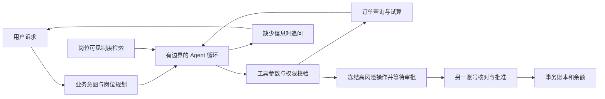

# NovaOrg AI 客诉处理与人工审批平台

[](https://github.com/linqin1375/novaorg/actions/workflows/ci.yml)

Java 17 · Spring Boot 3.5 · Function Calling · RAG · Spring Security · JDBC · H2

个人工程项目：模型理解客诉、选择工具并读取工具结果继续决策；确定性代码控制权限、审批、退款幂等和执行审计。订单为合成数据，退款仅写入本地沙箱账本。

## 核心能力

- 原生 assistant/tool 消息与 tool_call_id；工具结果回灌后继续决策。
- 业务意图约束岗位和工具；每步最多 3 轮，另有 token、耗时、工具数和重复调用限制。强制停止不会被当作完成。
- 缺少订单号暂停追问，申请人补充后恢复同一步骤；版本校验拦截过期提交。
- BM25 + 向量 + 领域概念的 RRF 检索；本地特征哈希与真实 embedding 严格区分，稳定文档/切块标识支持引用溯源。
- 高风险操作冻结参数与版本，另一账号审批后执行快照；事务账本、行锁和金额约束防止重复或超额退款。
- 持久化任务、审批、公开执行轨迹与审计。不展示模型隐藏推理，不记录 API 密钥。

## Windows 快速运行 零 API 成本

安装 JDK 17，进入项目目录：

```powershell
powershell -NoProfile -ExecutionPolicy Bypass -File scripts\start.ps1 -Mode demo -Port 8093
powershell -NoProfile -ExecutionPolicy Bypass -File scripts\show-credentials.ps1
```

访问 http://127.0.0.1:8093/ 。启动脚本生成 operator、reviewer、admin 随机密码并用本机 Windows DPAPI 保存。使用 operator 提交任务，另一 reviewer 账号审批。默认规则后端和本地特征检索不会调用付费 API。

跨平台构建与测试：

```sh
bash ./mvnw -B -ntp verify
```

Linux/macOS 启动时需按 [部署说明](docs/DEPLOYMENT.md) 为三个账号设置本地密码。

## 真实 DeepSeek 与 GLM Embedding

仓库不包含任何密钥。需要自己配置有效接口；Windows 通过隐藏输入保存本机加密配置：

```powershell
powershell -NoProfile -ExecutionPolicy Bypass -File scripts\configure-api.ps1 -LlmBaseUrl 'https://api.deepseek.com/v1' -LlmModel 'deepseek-flash' -EmbeddingBaseUrl 'https://open.bigmodel.cn/api/paas/v4' -EmbeddingModel 'embedding-3' -EmbeddingDimensions 1024
powershell -NoProfile -ExecutionPolicy Bypass -File scripts\stop.ps1
powershell -NoProfile -ExecutionPolicy Bypass -File scripts\start.ps1 -Mode live -Port 8093 -SkipBuild
```

live 模式会产生模型与向量 API 调用费用。GLM 请求显式指定 1024 维，返回维度或协议错误时明确失败，不偷偷降级成哈希特征。

## 验证结果及限制

| 验证 | 实际范围 |
|---|---|
| 自动化测试 | 本机历史构建 114 项通过；单元与集成测试含模拟模型，不代表 114 次真实模型对话 |
| HTTP / 重启 | 补订单追问、独立审批、重复审批 409、重启后任务/轨迹与余额恢复；规则模型环境 |
| 真实 DeepSeek | 历史三批原始结果 1/5、1/3、退款定向复测 1/1，旧失败报告保留 |
| 真实 GLM 检索 | 10 份制度、40 个切块，60 条开发查询与 20 条 AI 合成留出查询；没有调用聊天模型 |
| 留出集首位文档命中 | BM25 13/20，默认三通道 15/20，纯语义 18/20；不能当作回答准确率 |

退款定向聊天验收发生在 GLM 接入前；最终 DeepSeek + GLM 组合尚未重跑全部 live 用例。检索标签还需人工复核，引用存在不等于结论得到充分支持。没有宣称神经 reranker、真实 MCP 服务端或真实资金接入。

[指标与来源](docs/EVAL.md) · [真实聊天验收](docs/LIVE_VALIDATION_20261021.md) · [GLM 消融](docs/GLM_EMBEDDING_20261021.md) · [运行记录](reports/DELIVERY_20261021.json)

## 仅检索验收

```powershell
powershell -NoProfile -ExecutionPolicy Bypass -File scripts\evaluate.ps1 -Mode retrieval -AllowNetwork -SkipBuild
```

该命令调用 embedding API，不调用聊天模型；最多 200 段不同文本、20 万字符。真实聊天评测有独立请求/token 预算，详情见 [EVAL.md](docs/EVAL.md)。CI 只执行离线测试，不需要仓库配置付费模型密钥。

## 请求链路



代码采用 AI 辅助生成与改造，项目以可核查的实现、测试条件和失败记录展示工程取舍。公开快照从本次提交开始，未重建历史提交。当前默认适配器为直接 HTTP；可选 Spring AI profile 不改变默认运行方式。
